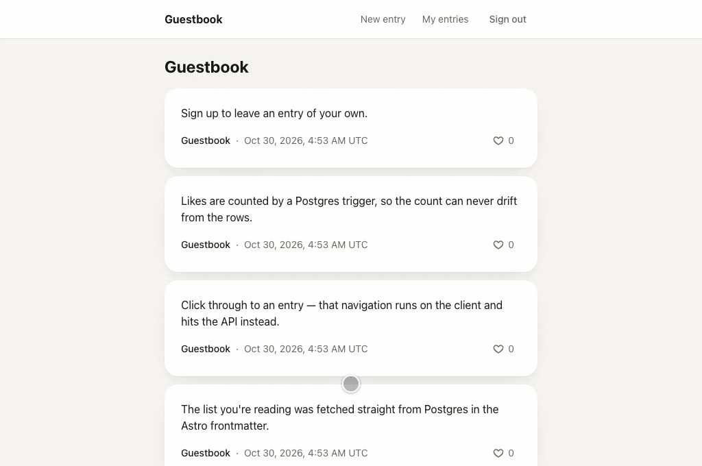

# astro-tanstack-kysely-starter

A fullstack starter: **Astro** SSR with **React** islands driven by **TanStack Router**, data loading through **TanStack Query** (the same cache filled on the server and hydrated on the client), **Kysely** over Postgres, **better-auth**, and **Tailwind CSS** — with **Storybook**, **Vitest** units and **Playwright** API + browser tests against the production Docker image.

The demo app is a tiny **guestbook**: a public list of entries, entry pages, sign-up/sign-in, an auth-only composer, "my entries", and optimistic likes counted by a Postgres trigger. Every feature exists to show one part of the stack — see [ARCHITECTURE.md](ARCHITECTURE.md). Working with a coding agent? [AGENTS.md](AGENTS.md) has the rules and recipes (`CLAUDE.md` imports it).



Also on a phone: [demo-mobile.gif](assets/demo-mobile.gif) · MP4s: [desktop](assets/demo-desktop.mp4), [mobile](assets/demo-mobile.mp4)

## Stack

|            |                                                                                                                          |
| ---------- | ------------------------------------------------------------------------------------------------------------------------ |
| Rendering  | Astro 7 (SSR, `@astrojs/node` standalone) + React 19                                                                     |
| Routing    | TanStack Router (file-based, SSR via a hand-rolled Astro bridge)                                                         |
| Data       | TanStack Query 5 — the `query()` / `infiniteQuery()` APIs (no deprecated `fetchQuery`/`prefetchQuery`/`ensureQueryData`) |
| Database   | Postgres 18 + Kysely, migrations + generated types (kysely-codegen)                                                      |
| Auth       | better-auth (email + password)                                                                                           |
| Validation | Zod 4, shared by API routes, fetch wrappers and forms                                                                    |
| Styling    | Tailwind CSS 4 with `light-dark()` semantic tokens                                                                       |
| Tooling    | oxlint (type-aware), `astro check`, Prettier, Storybook 10, Vitest, Playwright                                           |

## Getting started

Requires Node 24, pnpm and Docker.

```bash
pnpm install                # also points git at .githooks (see below)
cp .env.example .env        # then set BETTER_AUTH_SECRET (openssl rand -base64 32)
pnpm db:up                  # Postgres in Docker, on localhost:54320
pnpm db:migrate             # better-auth tables, then Kysely migrations (+ seed), then codegen
pnpm dev                    # http://localhost:4321
```

> **Heads-up: `pnpm install` changes your git config for this repo.** The `prepare` script runs `git config core.hooksPath .githooks`, which writes to this clone's `.git/config` (not your global config). From then on, git runs only the hooks in `.githooks/` — currently a pre-commit hook that runs `pnpm lint` — and ignores any hooks in `.git/hooks/` or a global `core.hooksPath` for this repo. Skip the hook once with `git commit --no-verify`; opt out entirely with `git config --unset core.hooksPath`.

## Commands

```bash
pnpm dev                    # dev server
pnpm build && pnpm start    # production build, served by node

pnpm lint                   # oxlint (TS/React, type-aware) + astro check (.astro files)
pnpm test                   # Vitest units (src/**/*.test.ts)
pnpm test:e2e               # Playwright against the Docker test stack (builds + boots it if needed)
pnpm test:e2e:dev           # Playwright against `pnpm dev` instead
pnpm storybook              # http://localhost:6006
pnpm demo:record [mobile|desktop]  # assets/demo-*.gif/.mp4 + screenshot-*.png (both if no arg)

pnpm db:init                # drop + recreate the dev DB, then migrate (+ seed)
pnpm db:migrate             # auth migrate → kysely migrate to latest → db:codegen
pnpm db:codegen             # regenerate src/db/schema.ts from the live DB
pnpm db:timestamp           # a prefix for a new migration file name

pnpm image:build            # build the production image (astro-tanstack-kysely-starter:local)
pnpm e2e:up / e2e:down      # boot / tear down the test stack (app on :4400)
```

### Recording the demo

`pnpm demo:record` drives the running dev server with Playwright and writes the GIF, MP4 and screenshot into `assets/`. It needs ffmpeg (`brew install ffmpeg`). It records against the first page of entries and likes a seed entry, so run it on a freshly seeded DB (`pnpm db:init`, which wipes the dev DB). Leftover test entries would otherwise push the seed entries off the page. Each take signs up a throwaway `demo-…@example.test` user and removes its entry and like afterwards. Set `DEMO_BASE_URL` to record another local stack. Never point it at production.

## Layout

```
src/
  pages/                 Astro pages (fill the query cache) + API routes (src/pages/api)
  components/            ReactServerEntry.astro — the SSR half of the router bridge
  react/                 router.tsx, ReactClientEntry.tsx, routes/, components/, hooks/
  lib/
    query-common.ts      query keys + QueryClient defaults (shared)
    query-server.ts      server options: queryFn reads the DB        ┐ same keys
    query-client.ts      client options: queryFn fetches the API     ┘
    queries/             server-only DB queries (import pg)
    schemas/             client-safe Zod schemas + types (never import db)
    fetch/               client fetch wrappers
    auth-server.ts, auth-client.ts
  db/                    Kysely: schemas/, functions/, migrations/, seed/, generated schema.ts
  constants.ts           limits shared by DB CHECKs and Zod schemas (imports nothing)
e2e/
  api/                   Playwright `request` specs (API contract)
  browser/               Playwright browser specs (chromium + mobile-safari)
```

## Deploying

The image migrates on start (`start-prod.sh`), then serves on `:4321`. Provide `DATABASE_URL` and `BETTER_AUTH_SECRET`, and add your domain to `baseURL.allowedHosts` in `src/lib/auth-server.ts`. Behind a TLS-terminating proxy, also set `advanced.trustedProxyHeaders: true` there so OAuth/callback URLs come out `https`.

## License

MIT
